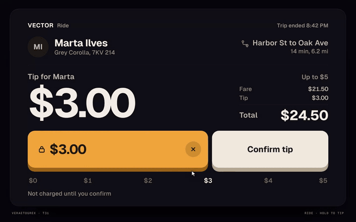

# Hold to Tip

**Hold the key and the tip counts up. Let go and the key splits into your tip and Confirm.**



**Live demo:** [veraetogrex-portfolio.github.io/hold-tip](https://veraetogrex-portfolio.github.io/hold-tip/) · **Mockup:** [full-screen version](https://veraetogrex-portfolio.github.io/hold-tip/mockup/hold-tip.html)

A ride-receipt screen with one wide amber key under the fare. Press and hold it: the key sinks, an amber fill grows from the left and the tip counts up at $2.50 a second, never past $5, with the tip line and the total following every frame. Let go and the amount stays: the key cracks where the fill ends, the filled part becomes a locked tip with its own ×, and the rest of the key turns into a separate Confirm tip button. Nothing is charged until you confirm.

## Use it

Three files, no build step, no dependencies, no web fonts:

```
index.html   markup
style.css    styles
script.js    hold, split and drain logic
```

Download the repo and open `index.html`, or copy the three files into your project.

## Try it

- Press and hold the key, let go around $3. The release settles to the nearest 25¢ and the key splits into the tip and Confirm tip.
- Tap the key too briefly (under 50¢) and the fill drains back with "Hold a little longer to add a tip".
- Hold past $5: the key says "Max $5, let go" and stops counting.
- Click Confirm tip: it turns into "Confirmed" and the line below says "$3.00 tip added for Marta".
- Click × on the tip (or press Esc): the key closes up and the fill drains to $0.00, the total walks back with it.
- Click $1…$5 under the key to set an exact amount without holding. Works before and after a tip is locked.
- Keyboard: Tab to the key and hold Space. Once a tip is locked, Tab moves to Confirm tip, the arrow keys change the tip by 25¢, Enter confirms, Esc clears.

## Make it yours

At the top of `script.js`:

- `MAX` and `RATE`: the highest tip and how many dollars a second it grows while held.
- `MIN` and `STEP`: a release below `MIN` drains back; above it the tip settles to the nearest `STEP`.
- `FARE`: the ride fare the total is built on.
- `W`, `H`, `GAP`, `R`: the key face size, the gap that opens at the split and the corner radius, in px (keep `W` in step with `.ht-keys` in `style.css`).

The driver, route and fare text live in `index.html`; the confirmation line ("tip added for Marta") is in `confirmTip()` in `script.js`. Colours live in `:root` in `style.css`: `--roast` for the key at rest, `--crema` for the fill and the locked tip, `--linen` for Confirm.

## What's in `mockup/`

The full 1440×900 screen this component was shot in for the reel:

- `mockup/hold-tip.html` — interactive. `D` plays the demo, `R` resets.
- `mockup/hold-tip.autoplay.html` — the scripted loop the reel was recorded from.
- URL flags: `?frame` puts the screen in a browser window, `?clean` hides the control panel, `?once` plays the demo once.

The mockup loads the same `style.css` and `script.js` from the root, plus a shared stage runtime and bundled fonts from `mockup/_shared/`. The component in the root doesn't need any of it.

---

Component 31 of a series. New one every day on Instagram [@veraetogrex_portfolio](https://www.instagram.com/veraetogrex_portfolio/) · all components: [github.com/veraetogrex-portfolio](https://github.com/veraetogrex-portfolio)

MIT licensed.
